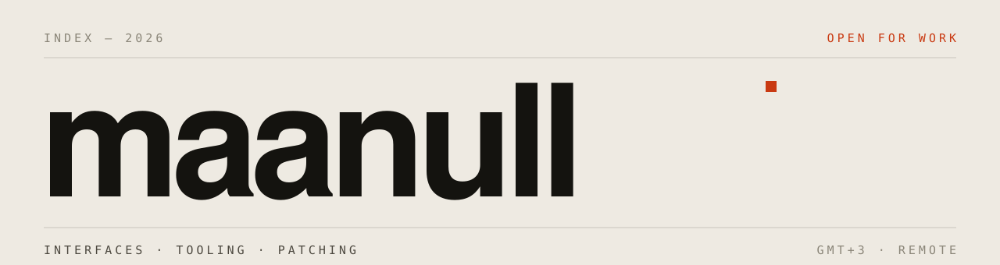

<div align="center">
  
</div>

<div align="center">
  
  
  
</div>

<br>

I design and build interfaces that feel handled — no template scaffolding,
no filler, no borrowed taste. Mostly for people who can tell the difference.
Design decisions get made in the browser, not in a deck: if it can't survive
being used, it doesn't ship.

---

## 001 · Selected work

### Antigravity Patcher Nextgen

`desktop` `patching` `network` `ui`

Antigravity doesn't officially exist in every country. This fixes that at the
binary — the region gate is handled before the app ever checks, no proxy
duct-taped to the launcher, no account gymnastics. One click, clean install.

```console
$ maanull status
target      antigravity · desktop
region      ru · unlocked
integrity   verified
patch       applied · 12 hooks
```

**[→ view project](https://github.com/maanull)**

---

## 002 · What I actually do

|  |  |
|:--|:--|
| **01** | **Interface design** — layout, type, hierarchy. The part you feel before you can name it. |
| **02** | **Front-end** — hand-written html, css and js. No framework debt, no build step to babysit. |
| **03** | **Reverse & patching** — binary work, region locks, integrity checks that get politely declined. |
| **04** | **Tooling** — small utilities that eat an hour of boring out of somebody's day. |

---

## 003 · Stack

<div>
  
  
  
  
  
  
  
</div>

---

## 004 · Contact

Got a thing worth making? Say something.

**discord** — `maanull` &nbsp;·&nbsp; **telegram** — `@maanull`

<br>

<div align="center">
  <sub>built by hand — no template · <a href="#top">back to top ↑</a></sub>
</div>
